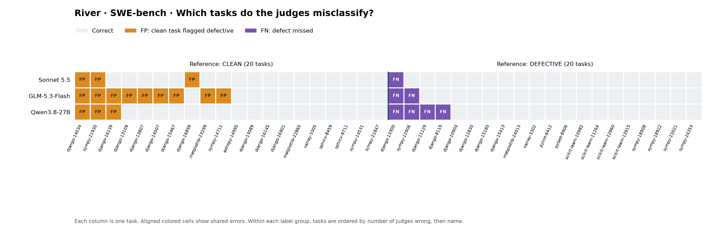
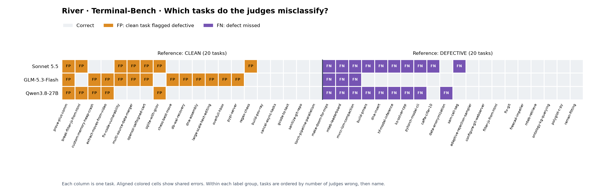
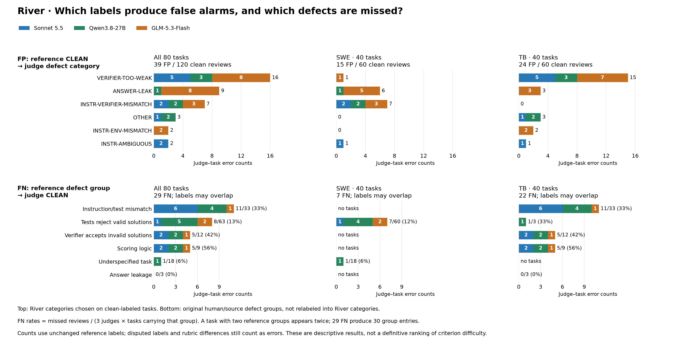

# Task-quality rubrics

We compare **five rubrics in six rubric/prompt configurations** on 80
human-annotated tasks. Three judges review every task in every configuration:
**Claude Sonnet 5.5, GLM-5.3-Flash and Qwen3.8-27B**, so 6 × 80 = 480 reviews per
judge and 1,440 in total.

## Tasks

The 80 tasks are in
[FWeindel/task-defect-ground-truth](https://huggingface.co/datasets/FWeindel/task-defect-ground-truth)
([judge-calibration-80/tasks.parquet](https://huggingface.co/datasets/FWeindel/task-defect-ground-truth/blob/main/judge-calibration-80/tasks.parquet)):

| Benchmark | Label | Tasks | Source | Confidence |
| --- | --- | ---: | --- | --- |
| SWE | Clean | 20 | [OpenAI SWE-bench audit](https://openai.com/index/introducing-swe-bench-verified/) ([annotations](https://cdn.openai.com/introducing-swe-bench-verified/swe-bench-annotation-results.zip)) | High |
| SWE | Defective | 20 | [OpenAI SWE-bench audit](https://openai.com/index/introducing-swe-bench-verified/) | High |
| TB | Clean | 20 | [Z.ai Terminal-Bench 2 Verified](https://huggingface.co/datasets/zai-org/terminal-bench-2-verified) publisher review | Moderate |
| TB | Defective | 10 | [Terminal-Bench 2 to 2.1 update](https://github.com/harbor-framework/terminal-bench-2/pull/53) | High |
| TB | Defective | 5 | [Z.ai targeted review (August 2026)](https://huggingface.co/datasets/zai-org/terminal-bench-2-verified), [pre-fix versions](https://huggingface.co/datasets/zai-org/terminal-bench-2-verified/tree/8b000db63b1217760921564ddf5c5dd724f10b57) | High |
| TB | Defective | 5 | [Epoch AI Terminal-Bench 4 review](https://epoch.ai/benchmarks/terminal-bench-4/review) | High |

[convert_swe_to_harbor.py](convert_swe_to_harbor.py) turns the SWE tasks
into Harbor tasks that run on Apptainer. The Terminal-Bench tasks are already Harbor tasks; we build their images for
Apptainer.

## Rubric overview

| Rubric | Prompt/output strategy | Prompt template |
| --- | --- | --- |
| [Terminal-Bench](rubric_terminal_bench/upstream/task-implementation.toml), with [our patches](rubric_terminal_bench/README.md) | Per-criterion pass/fail | [Terminal-Bench prompt](prompt_templates/modified/terminal_bench.txt) |
| [Harbor](rubric_harbor/upstream/default-rubric.toml), with [our patch](rubric_harbor/patches/remove-training-inapplicable-criteria.patch) | Per-criterion pass/fail | [Terminal-Bench prompt](prompt_templates/modified/terminal_bench.txt), with Harbor's rubric inserted |
| [Custom](rubric_custom/rubric.toml) | Per-criterion pass/fail | [Labeling prompt](prompt_templates/modified/labeling.txt) |
| [Custom classification](rubric_custom/classification.toml) | One category, including CLEAN | [Classification prompt](prompt_templates/modified/classification.txt) |
| [River](rubric_river/rubric.toml) | One category, including CLEAN | [Classification prompt](prompt_templates/modified/classification.txt) |
| [Custom severity](rubric_custom_severity/rubric.toml) | None/minor/major per criterion | [Severity prompt](prompt_templates/modified/custom_severity.txt) |

## Runtime configuration

By default, each judge inspects a **fresh sandbox using the task's actual
runtime** (`--review-evidence image`). It contains the task's starting files and
dependencies, plus the rubric, instructions, tests and reference solution for
review. 

**File-only review** (`--review-evidence files`) does not use the task's image.
The judge gets a copy of the task files under `/app/task-under-review` in a plain
`ubuntu:24.04` container with `curl`, `git`, `python3`, `nodejs`/`npm` and the
Claude Code CLI (Terminal-Bench's upstream review image). The task's
dependencies are not installed, so the judge can read the files but cannot run
the task's tests or demonstrate an exploit.


## Judge configuration

Choose the judge independently of the solver with `--judge-mode` and
`--judge-model`. These options apply to stages 5 and 8:

```bash
# Start a local server in the cluster allocation, using Terminus 2.
--judge-mode serve --judge-model Qwen/Qwen3-Coder-30B-A3B-Instruct

# Connect to an already running server, local or remote, using Terminus 2.
--judge-mode api --judge-model openai/my-model --judge-api-base http://HOST:8000/v1

# Provider API, using Terminus 2 and ANTHROPIC_API_KEY.
--judge-mode api --judge-model anthropic/MODEL_ID

# Optional custom credential variable (the name, never the secret).
--judge-mode api --judge-model openai/MODEL_ID --judge-api-key-env MY_JUDGE_KEY

# Supported CLI, using that CLI's own agent and authentication.
--judge-mode cli --judge-cli claude-code --judge-model MODEL_ID
--judge-mode cli --judge-cli codex --judge-model MODEL_ID
```

Append these arguments to `python validation/run.py /path/to/tasks --stages 5
--out /path/to/results`, with the usual runtime and cluster options. Existing
image-cache prerequisites still apply. `local` is accepted as an alias for
`serve`. For an existing endpoint, the model ID must match the name exposed by
that endpoint (with the API adapter prefix, such as `openai/`).

Serve mode accepts registered model keys and Hugging Face IDs. Known IDs reuse
registered hardware and sampling settings. Unregistered IDs use a generic
one-GPU, auto-dtype configuration; the model must be supported by vLLM and its
chat template. Prepare weights before submission, using `--serve-weights` for
an existing directory; the default location is `$OT_MODELS/ORG/MODEL` for an
unregistered ID. Existing `--serve-context`, `OT_SERVE_GPUS` and serving options
control resource configuration. This does not automatically download weights
or determine family-specific reasoning parsers.

API credentials use exported environment variables first, then `.env` in the
working directory, then `~/.env`. Set `OT_SECRETS_FILE` to select a different
file instead. `--judge-api-key-env` selects a custom variable instead of the
provider's standard variable. Missing custom credentials fail before review.
Only the variable name is stored in arguments and contracts. The custom-key
mapping supports OpenAI, hosted_vllm, Anthropic, Gemini, Together AI, Groq,
DeepSeek, Mistral, Cohere and OpenRouter; other adapters use their standard
credential environment variables. CLI authentication remains managed by the
CLI; Claude Code requires subscription OAuth in this pipeline.

`--model`, `--api-base` and `--agent` remain solver settings. New judge flags
cannot be mixed with conflicting legacy reviewer flags. Existing
`--review-local`, `--review-agent`, `--review-model`, `--analysis-agent` and
`--analysis-model` commands remain supported. With the legacy interface,
`--review-local` still reads `--model`. Rubric, evidence, timeout and retry
options are unchanged.


All judges run inside the reviewed task's own container, with the same prompt,
time limit and retries.

**Claude Sonnet 5.5** runs as Claude Code (Harbor's `claude-code` agent), signed
in with a Claude subscription:

- **Session timeout:** 30 minutes per review attempt.
- **Settings:** reasoning effort medium, no cost limit, all Claude Code tools
  except web search and web fetch, so it cannot look up published reviews of the
  tasks.
- **Usage limit:** if the subscription limit is reached, the review waits until
  the limit resets and then runs again.

**GLM-5.3-Flash and Qwen3.8-27B** are served locally with vLLM and run in
Terminus 2:

- **Session timeout:** 30 minutes per review attempt.
- **Context:** 131,072 tokens, with interleaved thinking.
- **Output per turn, including thinking:** 32,768 tokens for GLM-5.3-Flash,
  32,767 for Qwen3.8-27B.
- **Sampling:** each model's default from its model card.
  - GLM-5.3-Flash: temperature 1.0, top_p 0.95.
  - Qwen3.8-27B, thinking on: temperature 1.0, top_p 0.95, top_k 20, min_p 0,
    presence_penalty 0, repetition_penalty 1.0.

<details>
<summary><b>Retries and repairs</b></summary>

All judges:

- **Time limit:** after 30 minutes the judge gets 10 more minutes. Its next
  prompt (Claude Code: its next tool result) ends with:
  "The review time limit has been reached. Do not investigate further. Write
  /app/verdicts.json now from the evidence you have. You have 10 minutes."
  Harbor stops the agent at 42 minutes (30 + 10 + 2 slack).
- **Valid verdict at the hard limit:** if the agent is stopped but
  `verdicts.json` is already valid, the verdict is kept.
- **Invalid verdict at completion:** when the judge finishes, `verdicts.json`
  is checked. If it is invalid, the judge gets the exact error and is asked to
  correct the file, once, in the same session:
  "/app/verdicts.json is not valid, so the review cannot be accepted yet:
  &lt;error&gt;. Correct the file, then mark the task complete again."
- **One retry** (`--review-retries 1`): a fresh review with the exact same
  prompt and its own 30-minute timeout. Criteria missing from an otherwise valid
  verdict are retried with `/app/rubric.toml` reduced to them; a missing or
  unusable verdict, or a failed session, is retried with the full rubric.

Local judges only (Claude Code has no persistent terminal):

- **Lost terminal** (for example after `exit`, or `set -e` and a failing
  command): a new terminal is started in the same container, at most 3 times in
  a row, and the judge gets: "NOTE: The shell exited during your last command
  (for example after `exit`, or `set -e` followed by a failing command), which
  closed the terminal. A new terminal has been started in the same container.
  Files written so far are kept. The working directory, environment variables,
  shell options and any processes started from the old shell are gone. Commands
  that did not run before the shell closed were not repeated."
- **Unresponsive terminal:** if a command does not return in time, the
  container is checked again every 30 s until it answers or the hard limit is
  reached.

</details>
<br>

We skipped GLM-5.3. In a 3-task test on Helma, served across 2 nodes, it made only
14 model requests in 30 minutes and wrote no verdicts. A full review takes about
15-25 steps, so we estimated about 2 hours per review.

Earlier experiments tested **Claude Opus 5.5, Claude Fable 5.1, GPT-6 Astra
(medium), GLM-5.3 and GLM-5.3-Flash**. Their examples and results + pricing are in
[old/labeled_examples](old/labeled_examples).

## Results

Accuracy on all 80 tasks (40 clean, 40 defective), defective counted as positive.

| Rubric | Prompt/output strategy | Sonnet 5.5 | GLM-5.3-Flash | Qwen3.8-27B |
| --- | --- | ---: | ---: | ---: |
| Terminal-Bench | Per-criterion pass/fail | 54/80 (68%) | 42/80 (52%) | 46/80 (57%) |
| Harbor | Per-criterion pass/fail | 53/80 (66%) | 41/80 (51%) | 56/80 (70%) |
| Custom | Per-criterion pass/fail | 54/80 (68%) | 38/80 (48%) | 51/80 (64%) |
| Custom | Per-criterion, strict exploits | 54/80 (68%) | 41/80 (51%) | 51/80 (64%) |
| Custom | Classification | 56/80 (70%) | 44/80 (55%) | 54/80 (68%) |
| River | Classification | **59/80 (74%)** | **54/80 (68%)** | **59/80 (74%)** |
| Custom severity | Minor or worse = defective | 56/80 (70%) | 42/80 (52%) | 57/80 (71%) |
| Custom severity | Major only = defective | 56/80 (70%) | 42/80 (52%) | 56/80 (70%) |

By benchmark (40 tasks each: 20 clean, 20 defective). Sonnet and Qwen do much
better on SWE than on Terminal-Bench; on Terminal-Bench all three judges are
close to chance.

| Rubric | Prompt/output strategy | Sonnet SWE | Sonnet TB | GLM-Flash SWE | GLM-Flash TB | Qwen SWE | Qwen TB |
| --- | --- | ---: | ---: | ---: | ---: | ---: | ---: |
| Terminal-Bench | Per-criterion pass/fail | 35/40 (88%) | 19/40 (48%) | 22/40 (55%) | 20/40 (50%) | 28/40 (70%) | 18/40 (45%) |
| Harbor | Per-criterion pass/fail | 33/40 (82%) | 20/40 (50%) | 23/40 (57%) | 18/40 (45%) | 34/40 (85%) | 22/40 (55%) |
| Custom | Per-criterion pass/fail | 35/40 (88%) | 19/40 (48%) | 20/40 (50%) | 18/40 (45%) | 30/40 (75%) | 21/40 (52%) |
| Custom | Per-criterion, strict exploits | 35/40 (88%) | 19/40 (48%) | 22/40 (55%) | 19/40 (48%) | 30/40 (75%) | 21/40 (52%) |
| Custom | Classification | 34/40 (85%) | 22/40 (55%) | 22/40 (55%) | 22/40 (55%) | 33/40 (82%) | 21/40 (52%) |
| River | Classification | 36/40 (90%) | 23/40 (57%) | 29/40 (72%) | 25/40 (62%) | 33/40 (82%) | 26/40 (65%) |
| Custom severity | Minor or worse = defective | 34/40 (85%) | 22/40 (55%) | 20/40 (50%) | 22/40 (55%) | 31/40 (78%) | 26/40 (65%) |
| Custom severity | Major only = defective | 37/40 (92%) | 19/40 (48%) | 20/40 (50%) | 22/40 (55%) | 32/40 (80%) | 24/40 (60%) |

These reviews ran before the current judge configuration: Sonnet reviewed from
the host through an `inspect` tool, the local judges' history did not keep
earlier reasoning, Qwen3.8-27B used the model card's non-thinking sampling, and
up to 2 retries were allowed. GLM-5.3-Flash custom-criteria has no verdict for
one task, counted as wrong.

<details>
<summary><b>River details: accuracy, error overlap, and SWE analysis by judge</b></summary>

River scores highest for all three judges; all 240 reviews are resolved.

| Judge | Overall | SWE-bench | Terminal-Bench |
| --- | ---: | ---: | ---: |
| Sonnet 5.5 | 59/80 — 74% | 36/40 — 90% | 23/40 — 58% |
| GLM-5.3-Flash | 54/80 — 68% | 29/40 — 73% | 25/40 — 63% |
| Qwen3.8-27B | 59/80 — 74% | 33/40 — 83% | 26/40 — 65% |

**FP:** a clean-labeled task flagged defective. **FN:** a defective-labeled task
called clean. Counts use the original human labels, including disputed cases.

| Judge | Overall FP | Overall FN | SWE FP | SWE FN | TB FP | TB FN |
| --- | ---: | ---: | ---: | ---: | ---: | ---: |
| Sonnet 5.5 | 10 | 11 | 3 | 1 | 7 | 10 |
| GLM-5.3-Flash | 21 | 5 | 9 | 2 | 12 | 3 |
| Qwen3.8-27B | 8 | 13 | 3 | 4 | 5 | 9 |

Each column is a task; each row is a judge. Orange = FP, purple = FN, gray =
correct. Vertically aligned colors show shared errors.





| Judges wrong on the same task | SWE-bench | Terminal-Bench |
| --- | ---: | ---: |
| Sonnet + GLM-Flash | 3 | 7 |
| Sonnet + Qwen | 3 | 11 |
| GLM-Flash + Qwen | 5 | 6 |
| All three | 3 | 4 |
| At least one | 14 | 26 |

Pairwise counts include tasks missed by all three; the rows are not additive.

<details>
<summary><b>Errors by rubric criteria</b></summary>

Colors identify judges; each task contributes up to three reviews.



- **Top:** FP by the River category assigned. Weak-verifier findings account
  for the most false alarms (16), followed by answer leaks (9).
- **Bottom:** FN by the original human/source defect group. Instruction/test
  mismatch accounts for 11/33 missed reviews. Scoring logic has the highest
  observed rate (5/9), but represents only three tasks.

The two label sets differ. FN rates divide misses by three judges × tasks in
the group; overlapping groups give 30 entries for 29 FN. This is binary error
analysis, not a measure of whether judges chose the correct defect category.

[Counts and denominators](results/river-category-counts.json) ·
[Vector figure](results/river-errors-by-category.svg) ·
[Plot generator](utils/plot_river_categories.py)

</details>

Each task lists the human label, defective votes out of three, and reviewers’
confidence scores (**C**, 1–5).

<details>
<summary><b>Sonnet 5.5 — 4 SWE disagreements (3 FP, 1 FN)</b></summary>

Two interpretive cases and two suspected human-label problems. We lean toward
the judges on the latter two; independent confirmation is pending.

| Task | Error | Human label; votes; confidence | Assessment |
| --- | --- | --- | --- |
| `django__django-16899` | FP | Clean; 0/3; C 4, 5, 5 | **Interpretive.** The request says to name the invalid field using existing messages as examples. Sonnet accepts alternative wording; humans treat the examples as specifying the sentence pattern. |
| `django__django-13300` | FN | Defective; 3/3; C 5, 4, 4 | **Interpretive.** The request says to select a constant “like .exists()”. Tests also require removing sorting. Judges consider that implied; humans consider it an extra requirement. |
| `sympy__sympy-21930` | FP | Clean; 0/3; C 4, 4, 5 | **Possible human-label problem.** Judges report that tests demand tensor-formatting changes beyond the reported dagger bug. We lean toward the judges; not independently rerun. |
| `django__django-14034` | FP | Clean; 0/3; C 5, 5, 4 | **Possible human-label problem.** The issue concerns server validation; judges report that the decisive test checks HTML required attributes. We lean toward the judges; not independently rerun. |

GLM-Flash and Qwen share the last three disagreements. Both classify
Django-16899 correctly against the reference.

[Original judge explanations](results/river-task-results.json)

</details>

<details>
<summary><b>Qwen3.8-27B — 7 SWE disagreements (3 FP, 4 FN)</b></summary>

Three cases overlap with Sonnet. The four additional cases include a confirmed
miss, an answer-leak criterion difference, a wording dispute, and an unsupported
human criticism about summation.

| Task | Error | Human label; votes; confidence | Assessment |
| --- | --- | --- | --- |
| `django__django-13300` | FN | Defective; 3/3; C 5, 4, 4 | **Interpretive.** The request says to select a constant “like .exists()”. Tests also require removing sorting. Judges consider that implied; humans consider it an extra requirement. |
| `sympy__sympy-21930` | FP | Clean; 0/3; C 4, 4, 5 | **Possible human-label problem.** Judges report that tests demand tensor-formatting changes beyond the reported dagger bug. We lean toward the judges; not independently rerun. |
| `django__django-14034` | FP | Clean; 0/3; C 5, 5, 4 | **Possible human-label problem.** The issue concerns server validation; judges report that the decisive test checks HTML required attributes. We lean toward the judges; not independently rerun. |
| `django__django-11129` | FN | Defective; 3/3; C 5, 5, 4 | **Interpretive.** Tests require a specific exception and message for a request asking for a helpful error. Qwen considers Django conventions sufficient guidance; humans disagree. |
| `sympy__sympy-12906` | FN | Defective; 3/3; C 5, 4, 5 | **Summation objection unsupported.** A canonicalization-only fix passes all selected scored tests without changing summation code. This favors the judges on that criticism; canonical-form scope remains interpretive. |
| `django__django-8119` | FN | Defective; 3/3; C 5, 5, 5 | **Confirmed miss.** Changing only the error sentence to an equivalent explanation makes a scored test fail. The request never specifies that wording, supporting the human defect label. |
| `django__django-16139` | FP | Clean; 0/3; C 5, 5, 5 | **Different criteria.** The instruction supplies the reference fix: an answer leak under River, although humans reasonably judge the task clear and fairly tested. |

Local checks: the SymPy canonicalization-only fix passes 62 test items; an
equivalent Django-8119 error message causes exactly one failure. Django-16139’s
supplied fix was confirmed by source comparison. [Evidence](results/river-swe-verification.json).

</details>

<details>
<summary><b>GLM-5.3-Flash — 11 SWE disagreements (9 FP, 2 FN)</b></summary>

Five cases overlap with Qwen, including three shared with Sonnet. Of the six
additional cases, three disclose the fix, one is interpretive, and two have
reproduced test concerns. None establishes a wrong human label conclusively.

| Task | Error | Human label; votes; confidence | Assessment |
| --- | --- | --- | --- |
| `django__django-13300` | FN | Defective; 3/3; C 5, 4, 4 | **Interpretive.** The request says to select a constant “like .exists()”. Tests also require removing sorting. Judges consider that implied; humans consider it an extra requirement. |
| `sympy__sympy-12906` | FN | Defective; 3/3; C 5, 4, 5 | **Summation objection unsupported.** A canonicalization-only fix passes all selected scored tests without changing summation code. This favors the judges on that criticism; canonical-form scope remains interpretive. |
| `django__django-16139` | FP | Clean; 0/3; C 5, 5, 5 | **Different criteria.** The instruction supplies the reference fix: an answer leak under River, although humans reasonably judge the task clear and fairly tested. |
| `django__django-13807` | FP | Clean; 0/3; C 5, 5, 5 | **Interpretive; likely overflagged.** The issue diagnoses missing SQL quotes, but the reference fix requires additional table/column quoting. A detailed diagnosis is not the complete implementation. |
| `django__django-15467` | FP | Clean; 0/3; C 5, 5, 5 | **Answer disclosure, with a correction.** The instruction supplies the core fix, but differs from the reference for falsey values. GLM-Flash overstates the exact match. |
| `django__django-13109` | FP | Clean; 0/3; C 5, 5, 5 | **Answer disclosure.** The instruction prescribes the exact manager substitution made by the reference patch. River flags supplied answers; humans judge clarity and test alignment. |
| `sympy__sympy-14711` | FP | Clean; 0/3; C 5, 5, 5 | **Answer disclosure, with a correction.** The instruction’s traceback reveals the reference fix. Contrary to GLM-Flash’s claim, that commented fix is absent from the baseline source. |
| `sympy__sympy-21930` | FP | Clean; 0/3; C 4, 4, 5 | **Possible human-label problem.** Judges report that tests demand tensor-formatting changes beyond the reported dagger bug. We lean toward the judges; not independently rerun. |
| `django__django-14034` | FP | Clean; 0/3; C 5, 5, 4 | **Possible human-label problem.** The issue concerns server validation; judges report that the decisive test checks HTML required attributes. We lean toward the judges; not independently rerun. |
| `matplotlib__matplotlib-23299` | FP | Clean; 0/3; C 5, 4, 5 | **Reproduced scope difference.** A targeted fix preserves the reported figure but fails the backend-persistence test. It is not proven complete across backends, so a wrong human label remains unconfirmed. |
| `django__django-14007` | FP | Clean; 0/3; C 5, 5, 5 | **Reproduced weak-test concern.** A partial fix passes all 13 scored SQLite tests while bulk-insert paths remain unfixed; the bulk test skips. This tests a broader property than the human clean label. |

</details>

<details>
<summary><b>Individual human ratings for the 14 SWE disagreement tasks</b></summary>

Reviewers are numbered within each task. **U:** underspecification (0–3);
**T:** tests rejecting valid solutions (0–3); **O:** other major issues (0/1);
**C:** confidence (1–5). A defect vote means U ≥ 2, T ≥ 2, or O ≥ 1.
All 14 tasks have unanimous human binary labels.

| Task | Human label / defect votes | Reviewer 1 | Reviewer 2 | Reviewer 3 |
| --- | --- | --- | --- | --- |
| `django__django-11129` | Defective; 3/3 | U2 T3 O0; C5 | U1 T2 O0; C5 | U0 T2 O0; C4 |
| `django__django-13109` | Clean; 0/3 | U0 T0 O0; C5 | U0 T0 O0; C5 | U0 T0 O0; C5 |
| `django__django-13300` | Defective; 3/3 | U0 T3 O0; C5 | U0 T2 O0; C4 | U0 T2 O0; C4 |
| `django__django-13807` | Clean; 0/3 | U0 T0 O0; C5 | U0 T0 O0; C5 | U0 T0 O0; C5 |
| `django__django-14007` | Clean; 0/3 | U0 T0 O0; C5 | U0 T0 O0; C5 | U0 T0 O0; C5 |
| `django__django-14034` | Clean; 0/3 | U0 T0 O0; C5 | U0 T0 O0; C5 | U0 T0 O0; C4 |
| `django__django-15467` | Clean; 0/3 | U0 T0 O0; C5 | U0 T0 O0; C5 | U0 T0 O0; C5 |
| `django__django-16139` | Clean; 0/3 | U0 T0 O0; C5 | U0 T0 O0; C5 | U0 T0 O0; C5 |
| `django__django-16899` | Clean; 0/3 | U0 T0 O0; C4 | U0 T0 O0; C5 | U0 T0 O0; C5 |
| `django__django-8119` | Defective; 3/3 | U1 T2 O0; C5 | U3 T3 O1; C5 | U2 T2 O0; C5 |
| `matplotlib__matplotlib-23299` | Clean; 0/3 | U0 T0 O0; C5 | U0 T0 O0; C4 | U0 T0 O0; C5 |
| `sympy__sympy-12906` | Defective; 3/3 | U1 T3 O0; C5 | U1 T2 O0; C4 | U1 T3 O0; C5 |
| `sympy__sympy-14711` | Clean; 0/3 | U0 T0 O0; C5 | U0 T0 O0; C5 | U0 T0 O0; C5 |
| `sympy__sympy-21930` | Clean; 0/3 | U0 T0 O0; C4 | U0 T0 O0; C4 | U0 T0 O0; C5 |

Full human explanations are retained in [the task evidence](results/river-task-results.json).

</details>

[Verdicts and human annotations](results/river-task-results.json) ·
[Verification evidence](results/river-swe-verification.json) ·
[Plot generator](utils/plot_river_errors.py) ·
[Vector figures: SWE](results/river-errors-swe.svg), [TB](results/river-errors-tb.svg).
Local reproductions used isolated source copies, not the original container verifier.

</details>

Additional findings:

- **Most SWE tasks can be passed without fixing the bug.** SWE-bench runs the
  repository's own tests from a directory the agent can edit, resetting only the
  named test files, so an agent can change other files the tests load (a
  `conftest.py`, the test runner) to make them report success unfixed. This
  affects 39 of 40 SWE tasks, including all 20 clean ones (all in SWE-bench
  Verified); only `sphinx-doc__sphinx-9711` differs. It is an upstream property,
  not from our conversion. Note: the agent sees the verfier, which makes it easier to find the exploit and may not be found if we ask an agent to cheat without acess to the verifier/reference solution. 
