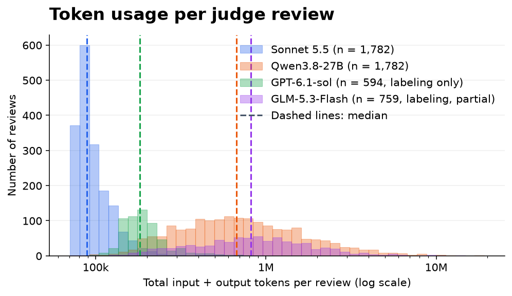

# LLM-as-a-Judge Filtering for RL Environments: Preliminary Results

**Main research question:** Which defect criteria are worth filtering to improve downstream RL performance?

Before running RL filtering ablations, we need to know whether the labels are reliable. Otherwise, a criterion might appear unhelpful simply because the rubric, prompting strategy, or judge assigns incorrect labels. These preliminary results aim to answer/make labels relaible. 

The main results are in [RQ3](#rq3--does-the-choice-of-judge-matter-can-a-cheaper-judge-be-reliable) (you can skip straight to it). The updated rubric is in [rubric_river_selected/rubric.toml](rubric_river_selected/rubric.toml). 

## RQ0: Can we build a reliable, minimally subjective ground-truth dataset?

We need ground truth labels that are not subjective but have an obvious defect to assess rubric quality, prompting strategy, and judge accuracy (RQ1-RQ3). Otherwise, disagreements may reflect genuinely debatable task requirements rather than a bad rubric or judge.

Existing benchmark audits give human-labeled clean and defective tasks, but our initial evaluations were often uninformative (sometimes near chance). One possible reason is that many audited benchmark tasks are already high-quality and have subtle, task-specific defects that even humans may disagree on. We do not want to specify every such edge cases into the rubric (too much work and too task specifc).

We therefore curated the [task-defect ground-truth dataset](https://huggingface.co/datasets/FWeindel/task-defect-ground-truth) from the following sources:

- **Clean (PASS):** Initially **66 SWE-bench Verified tasks** from the [OpenAI audit](https://openai.com/index/introducing-swe-bench-verified/), with unanimous agreement among three human reviewers and **5/5 confidence** on instruction clarity and test fairness. Follow-up inspection identified **four previously missed defects**, so we excluded those tasks. We also excluded `django-10097`: in our runtime even the reference solution gets reward 0, and the graded tests do not cover the requested fix. **Two additional cases remain PASS but are flagged as subjective**. The resulting set has **61 PASS tasks** (59 without the subjective flag).
- **Defective (FAIL):** Documented, reasonably objective defects from published benchmark audits and papers on auditing/curating RL environments, including [*Hardening Agent Benchmarks with Adversarial Hacker-Fixer Loops*](https://arxiv.org/abs/2606.08960), [*Learning Generalizable Behaviors for Terminal Agents*](https://arxiv.org/abs/2608.22631), [*Automated Benchmark Auditing*](https://arxiv.org/abs/2605.26079), [Terminal-Bench reviews](https://epoch.ai/benchmarks/terminal-bench-4/review), and TMax v1.1. We manually reviewed most cases. 
- **Additional PASS cases:** Hand-reviewed boundary examples where the judge should *not* report a defect: e.g., an agent can fix a missing service without inventing unavailable resources (`INSTR-ENV-MISMATCH`), or a weak-verifier issue where the only way to exploit it is by tampering with the verifier, rather than submitting a plausible but incorrect solution (`VERIFIER-TOO-WEAK`).

We excluded cases that could not be converted to Apptainer. 

## Setup

- **Judges:** Sonnet 5.5, Qwen3.8-27B and GLM-5.3-Flash, each run **three times per task** (GLM-5.3-Flash results are partial so far), and GPT-6.1-sol via Codex, run **twice per task** with labeling only.
- **Labeling:** Evaluate each rubric criterion independently as PASS/FAIL.
- **Classification:** Select one defect category or `CLEAN`.
- **Metrics:** Within-judge agreement across runs and accuracy against gt labels (plus TP/FN/FP/TN). 
- All reported judge results use the **selected River rubric saved with the runs**. Some refinements below were already included; later additions are marked as not yet evaluated.

## RQ1 — Can we build a rubric that produces consistent, minimally subjective judgments?

Using the River rubric, we measure how often all six Sonnet reviews agree: three labeling and three classification runs per task.

| Criterion / decision | Agreement |
|---|---:|
| CLEAN (all criteria) | 48/59 (**81.4%**) |
| CLEAN (excluding answer leakage and triviality) | 58/59 (**98.3%**) |
| VERIFIER-TOO-WEAK | 68/75 (**90.7%**) |
| INSTR-VERIFIER-MISMATCH | 155/176 (**88.1%**) |
| INSTR-AMBIGUOUS | 64/72 (**88.9%**) |
| INSTR-ENV-MISMATCH | 103/118 (**87.3%**) |

Looking at the disagreements showed confusion between answer leakage and triviality, triviality and CLEAN, and ambiguity and mismatch. Leakage, triviality and CLEAN were confused when the instruction suggested how to fix the problem, and whether a task is trivial is itself subjective. We clarified the ambiguity/mismatch boundary with adjutments to the rubric described below (but not yet all tested). 

### Changes made to the rubric (including changes already used in these experiments)

#### VERIFIER-TOO-WEAK: separate incomplete work from shortcuts

We split this criterion into two categories (not yet evaluated):

- **VERIFIER-ACCEPTS-INCOMPLETE:** A solution completes only part of the requested work, but the verifier accepts it.
- **VERIFIER-ACCEPTS-SHORTCUTS:** A fabricated output or hardcoded answer passes without solving the task. 

Tasks with incomplete verification may still be useful for training because the agent must perform meaningful work. For example, if a task combines two smaller tasks but the verifier checks only the first, the agent can still learn from solving that first task. Extending the verifier to check both would effectively **harden the task**, much like combining several smaller tasks into a harder one. For example, `portfolio-optimization` checks numerical correctness and speed but does not check that the implementation uses C. A fast, correct NumPy implementation could still involve useful work, even though it misses a stated requirement.

For both new criteria, we added **“Assign FAIL only if you demonstrate”** that the incomplete solution or shortcut passes **“without tampering with the tests or scoring”** (not yet evaluated). In some disagreements, the judge assigned FAIL based on a hypothetical example. We then tried implementing it with GPT-6 Astra: it either did not work or required substantial work comparable to solving the task, suggesting that an agent would be unlikely to exploit it.

For `VERIFIER-ACCEPTS-INCOMPLETE`, we also added: “Check that relevant tests affect the final score, not just that they are present or executed” (not yet evaluated), because judges sometimes confused test presence or execution with actual grading coverage.

#### INSTR-VERIFIER-MISMATCH: clarify arbitrary or contradictory requirements

We split this criterion into two (not yet evaluated): **INSTR-VERIFIER-CONTRADICTION** (the verifier contradicts the instruction or the environment, e.g. a different path or a hardcoded value that conflicts with the data) and **INSTR-VERIFIER-UNSTATED-REQUIREMENT** (the verifier checks an arbitrary requirement not specified by the instruction, e.g. exact error messages or output keys). Qwen and GLM-5.3-Flash often pass tasks because the tests target the requested feature, without checking whether the instruction states each specific the tests require; a separate criterion asks this question directly. The changes below now apply to one of the two criteria.

We changed “checks something the instruction does not imply” to **“checks an arbitrary requirement”** (not yet evaluated) to distinguish mismatch from ambiguity: choosing between reasonable edge-case behaviors (e.g., returning `None` or raising an exception) is ambiguity; requiring an exact, unspecified error message is mismatch.

We removed “A solution that faithfully follows the instruction still fails” (not yet evaluated) because this can also describe ambiguity: a solution may follow a reasonable interpretation of the instruction and still fail. Qwen also often used this sentence to incorrectly pass tasks with this defect: it took the reference solution as the faithful solution, saw it pass, and concluded PASS (e.g. `django-15703`), although an agent never sees the reference solution.

We therefore added: “Judge only from what the agent can see, not the task's tests/ or solution/ directories. A requirement is not implied just because the reference solution or hidden tests satisfy it” (the revised-rubric runs used an earlier version that named only the reference solution; the current wording is not yet evaluated). Much of Qwen’s run-to-run disagreement on mismatch comes from this: some runs flag an unspecified exact error message, while others pass it because it is exactly what the reference fix produces.

We also added: “Check hardcoded expected values, paths and hashes against the provided data and environment” (not yet evaluated), because Sonnet often only checked that tested paths and values appear in the instruction, not that they are correct (e.g. a binary path the build never produces in `caffe-cifar-10`).

We added “rejects build artifacts created by the instruction’s own compilation commands” (not yet evaluated) based on disagreements over `polyglot-rust-c`. The task asks for a single source file, `main.rs`, but the supplied compilation commands create executable files alongside it. The verifier rejects those additional files. Following the supplied compilation commands creates additional files, so the verifier rejects the resulting directory unless the agent deletes those build artifacts.

We also added these examples: “requires specific output keys not stated in the instruction, or requires exact warning/error messages or other prose wording that the instruction does not specify” (already included in the experiments). 

One proposed change

The following file-scope clarification is **proposed, but not yet implemented** in either selected rubric:

> Do not flag tasks where the instruction points to specific files, but the verifier expects the same requested change in additional files or code paths, unless the instruction explicitly restricts changes to those files.

For example, `django-14376` asks to replace deprecated MySQL parameter names (`db` → `database`, `passwd` → `password`) and points to the database connection file. The verifier also expects the corresponding update in the file used to launch the MySQL command-line client. The judge flagged this as an unstated requirement because the instruction did not name that second file. However, the instruction does not restrict changes to the named file: finding and updating other code that uses the same parameters may reasonably be part of completing the requested change. We may therefore want to keep this task rather than flag it as a mismatch. But unsure if the proposed text makes this clear without being too specifc to this example. 

#### INSTR-AMBIGUOUS: clarify unspecified edge-case behavior

We added: “For example, the expected behavior for an edge case is unclear, and the verifier accepts only one of several reasonable behaviors” (not yet evaluated). This makes cases such as `django-14534` (returning `None` versus raising `KeyError` when no widget ID exists) should be ambiguity not mismatch. 

#### INSTR-ENV-MISMATCH: distinguish fixable setup from missing resources

We added an exception for fixable setup issues: “Do not flag if the agent can resolve the issue by installing, configuring, or starting available software or services” (already included in the experiments as “available components”). We clarified what should still be flagged: “Flag if resolving it requires inventing missing data or implementing a service or program that the instructions assume is already provided” (already included in the experiments).

We also added: “Check resources needed for grading as well as solving” (not yet evaluated). Some disagreements was because somethimes the judge assumed grading resources were available, other times it explcitly checked. 

## RQ2 — Does the prompting strategy matter (labeling vs. classification)?

CLEAN shows how often the judge correctly passes the 59 clean tasks; each defect column shows how often it identifies that specific defect. All rates average three reviews per task. GLM-5.3-Flash rows are partial: they include only tasks whose three reviews are complete so far.

| Judge / strategy | CLEAN | Weak verifier | Verifier mismatch | Ambiguity | Environment mismatch |
|---|---:|---:|---:|---:|---:|
| Sonnet 5.5 / Labeling | 176/177 (99.4%) | 32/48 (66.7%) | 305/351 (86.9%) | 26/39 (66.7%) | 149/177 (84.2%) |
| Sonnet 5.5 / Classification | 177/177 (100.0%) | 25/48 (52.1%) | 282/351 (80.3%) | 16/39 (41.0%) | 149/177 (84.2%) |
| Qwen3.8-27B / Labeling | 167/177 (94.4%) | 38/48 (79.2%) | 201/351 (57.3%) | 13/39 (33.3%) | 172/177 (97.2%) |
| Qwen3.8-27B / Classification | 158/177 (89.3%) | 22/48 (45.8%) | 180/351 (51.3%) | 10/39 (25.6%) | 168/177 (94.9%) |
| GLM-5.3-Flash / Labeling (partial) | 158/159 (99.4%) | 27/33 (81.8%) | 167/288 (58.0%) | 15/27 (55.6%) | 172/177 (97.2%) |
| GLM-5.3-Flash / Classification (partial) | 158/162 (97.5%) | 22/30 (73.3%) | 172/279 (61.6%) | 10/27 (37.0%) | 93/99 (93.9%) |

*CLEAN excludes answer leakage and triviality because some reference-PASS tasks contained Git-history leakage, already covered by a rule-based check. It also excludes environment mismatch because we blocked network access for the judge so it could not look up labels, but this broke setup scripts needing internet. Defect columns use the same cases as RQ1, excluding the two known multi-defect tasks. Environment-mismatch results can reflect our runtime restrictions.*

**Answer:** Labeling detects the reference defects more often, but the comparison is confounded by labeling allowing multiple categories while classification selects only one.

## RQ3 — Does the choice of judge matter? Can a cheaper judge be reliable?

Here we hold the prompting strategy fixed at **labeling** and compare Sonnet, Qwen, GPT-6.1-sol and GLM-5.3-Flash on the same tasks. GPT-6.1-sol ran through Codex with the same rubric and settings, but with only **two reviews per task**. GLM-5.3-Flash results are **partial**: they include only tasks whose three reviews are complete so far, so its denominators are smaller.

**Known defects correctly identified, using the majority of three reviews (GPT-6.1-sol: both of its two reviews):**

| Judge / format | Weak verifier | Verifier mismatch | Ambiguity | Environment mismatch |
|---|---:|---:|---:|---:|
| Sonnet 5.5 / Labeling | 11/16 (68.8%) | 101/117 (86.3%) | 9/13 (69.2%) | 51/59 (86.4%) |
| Qwen3.8-27B / Labeling | 12/16 (75.0%) | 67/117 (57.3%) | 5/13 (38.5%) | 58/59 (98.3%) |
| Qwen3.8-27B / Labeling, revised rubric | 15/16 (93.8%) | 77/117 (65.8%) | 3/13 (23.1%) | 57/59 (96.6%) |
| GPT-6.1-sol / Labeling | 16/16 (100.0%) | 111/117 (94.9%) | 8/13 (61.5%) | 59/59 (100.0%) |
| GLM-5.3-Flash / Labeling | 13/16 (81.3%) | 71/117 (60.7%) | 6/13 (46.2%) | 58/59 (98.3%) |
| GLM-5.3-Flash / Labeling, revised rubric | 16/16 (100.0%) | 87/117 (74.4%) | 4/13 (30.8%) | 58/59 (98.3%) |

Sonnet, Qwen and GLM-5.3-Flash (partial) mostly miss the same weak-verifier tasks. Qwen and GLM-5.3-Flash only check whether the behavior is really tested or a fabricated output could pass; they rarely try a plausible partial solution to see whether it passes. Sonnet sometimes sees the gap but calls it minor. Most missed tasks fall under `VERIFIER-ACCEPTS-INCOMPLETE` in the revised rubric, where it is unclear whether filtering helps, so these misses are a smaller problem.

On verifier mismatch, Sonnet misses 16 and GPT-6.1-sol 6, with four shared. Sonnet's misses mostly come from not checking values (e.g. hardcoded paths, hashes or expected numbers that conflict with the environment), which the revised rubric now addresses (not yet evaluated), while GPT-6.1-sol's are mostly borderline labels. Qwen and GLM-5.3-Flash (partial) miss more: they mostly check whether the verifier contradicts the instruction (e.g. a different path or a conflicting value), but not whether it requires details the instruction never states, or they call such details implied because the reference solution uses them. We therefore split the criterion into `INSTR-VERIFIER-CONTRADICTION` and `INSTR-VERIFIER-UNSTATED-REQUIREMENT`, so the judge must check both defects separately, and added that a requirement is not implied just because the reference solution satisfies it (not yet evaluated).

On ambiguity, Sonnet's misses are another case of seeing the problem but calling it minor. GPT-6.1-sol mostly labels its misses as verifier mismatch instead, so it still flags the task. Qwen and GLM-5.3-Flash (partial) miss more because they often assume missing details can be inferred from the codebase or the reference fix.

On environment mismatch, Sonnet's misses mostly come from assuming that missing grading data will be supplied later, which the revised rubric now clarifies (not yet evaluated).

**Results, revised rubric:** Splitting weak verifier fixed most of the misses: all newly detected tasks are caught by `VERIFIER-ACCEPTS-INCOMPLETE`. Instead of only running the base code and the reference solution, the judges now remove a stated requirement from the reference solution and show that the verifier still passes. Splitting verifier mismatch raised detection because the judges now also check unstated requirements, not only contradictions. Most remaining misses are SWE tasks whose tests require an exact message, name or key that the judges consider visible to the agent: the upstream fix is in the repository's git history, which we did not strip for these runs, or the detail follows a codebase convention. Ambiguity and environment changes are within run-to-run noise.

**Clean tasks correctly passed for each criterion, using the same majority rule (GPT-6.1-sol: both reviews pass):**

| Judge / format | Weak verifier | Verifier mismatch | Ambiguity | Environment mismatch |
|---|---:|---:|---:|---:|
| Sonnet 5.5 / Labeling | 59/59 (100.0%) | 59/59 (100.0%) | 59/59 (100.0%) | 59/59 (100.0%) |
| Qwen3.8-27B / Labeling | 59/59 (100.0%) | 58/59 (98.3%) | 59/59 (100.0%) | 59/59 (100.0%) |
| Qwen3.8-27B / Labeling, revised rubric | 52/59 (88.1%) | 57/59 (96.6%) | 59/59 (100.0%) | 59/59 (100.0%) |
| GPT-6.1-sol / Labeling | 4/59 (6.8%) | 55/59 (93.2%) | 59/59 (100.0%) | 59/59 (100.0%) |
| GLM-5.3-Flash / Labeling | 59/59 (100.0%) | 59/59 (100.0%) | 59/59 (100.0%) | 59/59 (100.0%) |
| GLM-5.3-Flash / Labeling, revised rubric | 53/59 (89.8%) | 59/59 (100.0%) | 59/59 (100.0%) | 59/59 (100.0%) |

**Why GPT-6.1-sol fails weak verifier on 55/59 clean tasks:** it tested the definition's "does not check one or more requirements stated in the instructions" systematically, and most SWE-bench tests are a single regression test (e.g. special-casing the one tested value in `django-11206` passes). Sonnet and Qwen mostly only checked that the tests run the code and compare real results. The revised rubric therefore separates `VERIFIER-ACCEPTS-INCOMPLETE` from `VERIFIER-ACCEPTS-SHORTCUTS`.

**Why GPT-6.1-sol fails verifier mismatch on 4/59 clean tasks:** three are debatable mismatches (`django-13807`, `-11299`, `-14170`). The fourth, `sphinx-8475`, was a grading bug in our task conversion that Qwen also reported: `setup.sh` dropped the SWE-bench image commit that adds `-rA` to pytest, so the reference solution passed all tests but got reward 0 (verified by running the verifier). We have fixed this for all 74 affected SWE tasks on HF; the judge results above used the earlier packages. We have since fixed `setup.sh` for all 74 affected SWE tasks on HF; the judge runs above used the old packages.

**Results, revised rubric:** `VERIFIER-ACCEPTS-INCOMPLETE` fails 7 (Qwen) and 4 (GLM-5.3-Flash) clean tasks, mostly real gaps in the SWE-bench tests (e.g. a backend or code path named in the issue is never tested); two demonstrations hardcode the tested input and belong under `ACCEPTS-SHORTCUTS`.

**Agreement across three runs (GPT-6.1-sol: two runs), on each defect set plus the same 59 clean tasks:**

| Judge / format | Weak verifier | Verifier mismatch | Ambiguity | Environment mismatch |
|---|---:|---:|---:|---:|
| Sonnet 5.5 / Labeling | 70/75 (93.3%) | 165/176 (93.8%) | 71/72 (98.6%) | 110/118 (93.2%) |
| Qwen3.8-27B / Labeling | 70/75 (93.3%) | 128/176 (72.7%) | 68/72 (94.4%) | 112/118 (94.9%) |
| Qwen3.8-27B / Labeling, revised rubric | 57/75 (76.0%) | 126/176 (71.6%) | 66/72 (91.7%) | 111/118 (94.1%) |
| GPT-6.1-sol / Labeling | 69/75 (92.0%) | 172/176 (97.7%) | 70/72 (97.2%) | 118/118 (100.0%) |
| GLM-5.3-Flash / Labeling | 69/75 (92.0%) | 141/176 (80.1%) | 68/72 (94.4%) | 115/118 (97.5%) |
| GLM-5.3-Flash / Labeling, revised rubric | 64/75 (85.3%) | 150/176 (85.2%) | 66/72 (91.7%) | 116/118 (98.3%) |

Qwen and GLM-5.3-Flash agree less on verifier mismatch because their runs apply two standards to the same evidence: some runs flag an exact message, name or key that the instruction never states, while others pass the same task because the tests match the upstream or reference fix. Adding “Judge only from what the agent can see, not the task's tests/ or solution/ directories. A requirement is not implied just because the reference solution or hidden tests satisfy it” should fix this (not yet evaluated).

**Results, revised rubric:** Agreement on weak verifier fell almost entirely on clean tasks: the judges now try to demonstrate a passing partial solution or hardcoded answer, and because many SWE-bench tests check a single fixed input, such a solution often exists, but only some runs find it.

**Conclusion:** GPT-6.1-sol is the strictest judge and Sonnet the most conservative: Sonnet often sees a defect but calls it minor. Qwen and GLM-5.3-Flash (partial) behave similarly: both are conservative on instruction problems (mismatch, ambiguity) but flag more environment problems than Sonnet. Most of their misses follow systematic patterns that the revised rubric now addresses (not yet evaluated). Each judge repeats its own decisions consistently across runs, except Qwen (72.7%) and GLM-5.3-Flash (81.9%) on verifier mismatch, which the revised rubric should fix (not yet evaluated).
## Estimated costs

The histogram includes **1,782 reviews each for Sonnet and Qwen**: 297 matched tasks × 3 runs × 2 prompting strategies. Three of the original 300 common tasks were excluded from both models because Sonnet usage logs were incomplete. GPT-6.1-sol has **594 reviews** on the same 297 tasks: labeling only, two runs. GLM-5.3-Flash has **759 labeling reviews** on the 253 of these tasks completed so far.

Total tokens include input, cached input and output across all calls in a review. The horizontal axis is logarithmic; dashed lines mark medians.

**API prices in USD per million tokens:**

| Model | Uncached input | Cached input read | Cache write | Output |
|---|---:|---:|---:|---:|
| Sonnet 5.5 | $2.00 | $0.10 | $2.50 (5 min) / $4.00 (1 hour) | $10.00 |
| Qwen3.8-27B | $0.50 | $0.10 (implicit caching) | No separate charge for implicit caching | $3.00 |
| GPT-6.1-sol | $2.00 | $0.10 | None reported by Codex | $10.00 |
| GLM-5.3-Flash | $0.15 | $0.03 | Storage free for a limited time | $0.50 |

Rates checked November 6, 2026: [Anthropic](https://platform.claude.com/docs/en/about-claude/pricing) and [Alibaba Cloud, Singapore/international](https://www.alibabacloud.com/help/en/model-studio/qwen3-8-27b); GPT-6.1-sol checked November 7, 2026: [OpenAI](https://developers.openai.com/api/docs/pricing), standard tier for requests up to 272K input tokens; GLM-5.3-Flash checked November 7, 2026: [Z.ai](https://docs.z.ai/guides/overview/pricing). Sonnet’s logs use one-hour cache writes. Twelve reviews also contain Sonnet 5 usage, charged at its $0.20/M cache-read rate; its other rates are the same.

**Estimated cost per review, including caching:**

| Judge | Labeling | Classification |
|---|---:|---:|
| Sonnet 5.5 | **$0.0625** | **$0.0562** |
| Qwen3.8-27B | **$0.2495** | **$0.1909** |
| GPT-6.1-sol | **$0.0849** | not run |
| GLM-5.3-Flash | **$0.0570** (partial) | not yet estimated |

Unexpectedly, Qwen is more expensive per review because it uses far more tokens: an average of 1,055,710 input and output tokens, compared with 101,770 for Sonnet, across both prompting strategies. GPT-6.1-sol uses about twice as many tokens as Sonnet for labeling (202,540 vs. 102,621 on average) at similar rates, so it costs about 36% more per review. GLM-5.3-Flash also uses many tokens (1,126,020 per labeling review on average), but its low rates make it the cheapest; this estimate covers 759 accepted labeling reviews on 253 of the 297 tasks completed so far.

**Local models: time and concurrency.** In the revised-rubric runs on Helma H200s, Qwen ran 12 parallel reviews per GPU and GLM-5.3-Flash 24 per 4-GPU node. The 297 tasks (≈890 labeling reviews) took 5.7 h on up to 10 GPUs for Qwen and 3.7 h on up to 32 GPUs for GLM-5.3-Flash: about **20 reviews per GPU-hour for Qwen** and **13 for GLM-5.3-Flash** (median review 21 and 14 min; model startup 6 and 21 min per job). Processing 1,000 tasks with one review each would take about 50 GPU-hours with Qwen (≈5 h on 10 GPUs) or 77 with GLM-5.3-Flash (≈2.5 h on 8 nodes).

| Judge | Parallel reviews | KV cache use, median | KV cache use, peak | Output tokens/s, total | Output tokens/s per review |
|---|---:|---:|---:|---:|---:|
| Qwen3.8-27B (1 H200) | 12 | 36% | 63% (worst 77%) | 291 | 37 |
| GLM-5.3-Flash (4 H200) | 24 | 21% | 35% (worst 39%) | 902 | 60 |

The KV cache leaves room for about 48 parallel reviews with GLM-5.3-Flash and 16 with Qwen (throughput not yet measured). Jobs that use the full 24 h limit also cut startup from 16% to under 2% of the job time.

## Why the criteria themselves need RL ablations

Even an accurately detected defect may not justify filtering a task:

| Criterion | Example / open question |
|---|---|
| Environment mismatch | If an agent can simply start a missing service, doesn't it make the task just harded? ([TMax example](https://hub.harborframework.com/tasks/tmax/task_001197_680abe08)) |
| Weak verifier | If the task rewards correct and fast NumPy code but not the requested C implementation, might it still teach useful behavior? ([Portfolio optimization](https://hub.harborframework.com/tasks/terminal-bench/portfolio-optimization)) |
| Instruction–verifier mismatch | Could discovering additional related code paths be part of solving the task, rather than a defect? (`django-14376`) |
| Ambiguity | Does requiring a reasonable implicit edge-case behavior actually harm learning? (`django-14534`) |
| Triviality | A task trivial for a strong judge may still challenge the model being trained. |
| Answer leak | Suggested fixes may still require meaningful work, unlike an accessible exact reference solution which we catch with rules. |

